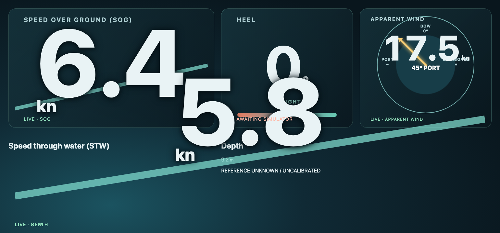

# Telltales

Telltales is an open-source experiment in **useful, configurable sailing instrumentation and telemetry displays**: reusable widgets composed into displays, fed by explicit observation contracts and open data interfaces.

The immediate target is a 1540 × 720 sailing HUD used in a separate browser window from its simulator. The broader idea is to make instruments, layouts and data sources replaceable without turning the display into a protocol-specific or boat-specific application.

Telltales is experimental software, **not a navigation instrument**. It does not replace required or trusted navigation equipment.



## What works today

The repository currently demonstrates:

- a fullscreen-oriented 1540 × 720 HUD and separate engineering/simulator window;
- reusable speed, apparent-wind and depth widgets plus heel presentations;
- simulated SOG, STW, heel, apparent wind and depth observations;
- recording and replay, including synthetic JSON recordings and NMEA RMC/MWV file import;
- versioned same-browser transport using `BroadcastChannel`, with snapshots, heartbeat and failure handling;
- an optional local Signal K round trip while keeping widgets transport-independent;
- declarative observations, sources, widgets, templates and display profiles in `config.json`;
- synthetic boat-installation examples with semantic template matching, provenance and freshness states, without claiming connectivity;
- automated Node contract tests and Chromium browser coverage.

The full HUD displays SOG, STW, heel, apparent wind and depth. Depth is deliberately labelled with an unknown/uncalibrated reference rather than implying a keel, surface or transducer datum that has not been established. The committed virtual sources and example recordings are simulation/test inputs, not claims of live boat hardware support.

## Try it

Telltales uses Node.js for local development and tests.

```sh
npm ci
npm start
```

Open the simulator:

```text
http://localhost:4173/?view=simulator
```

Then open the full sailing HUD in a separate browser window:

```text
http://localhost:4173/?view=hud&template=sailing-hud-full
```

The server binds to `127.0.0.1:4173` by default. The simulator owns virtual inputs, imports, recording and replay; the HUD subscribes to observations and contains no engineering controls.

For a smaller composition, use `sailing-hud`. For the wind-enabled composition, use `sailing-hud-wind`. Browser fullscreen can be entered with F11 or the simulator's user-initiated **Fullscreen** action where supported.

The synthetic installation fixture is available at `/?view=hud&sensorSession=heel-demo`. It is a presentation-only HUD: setup choices are not controls on that screen. `sensor-groups-demo.html?session=heel-demo&harness=true` is the clearly labelled engineering harness. Both are synthetic only and do not connect to phones, other boats, shore stations, or any remote service.

The opt-in external-surface demonstration is also synthetic only: open `/?view=surface-fixture`, `/?view=hud&template=zo-hud-surface`, and the simulator in separate windows. It demonstrates frame lifecycle and composition beneath an overlay dial; it is not a charting or navigation system.

More detail lives in the focused technical documents:

- [Widget catalogue and contracts](WIDGETS.md)
- [Configuration and templates](CONFIGURATION.md)
- [Signal K development route](SIGNALK.md)

## Why Telltales exists

Small-boat instrumentation often mixes concerns that are easier to change when kept separate: where a value came from, what it means, how it is transformed, how it is displayed, and how the display is arranged for a particular screen.

Telltales explores a deliberately small set of seams between those concerns. A display widget should not need to know whether an observation came from a simulator, a recording, Signal K or a future physical adapter. Configuration should make bindings and layout inspectable. Replay and explicit provenance should make it possible to test behaviour before trusting new integrations.

The current sailing HUD is the proving ground for those ideas. Reuse beyond that is a direction to be earned through useful examples and evidence, not a promise of a generic framework or a fixed roadmap.

## Development model

Telltales is intentionally **AI-led, with human direction and oversight**.

AI agents perform much of the repository investigation, implementation, testing, documentation and maintenance work. Humans provide purpose, real-world evidence, constraints and review; retain authority over consequential decisions; and can challenge or redirect the work. The project values working software, accurate claims and useful evidence over novelty in how the work is produced.

"AI-led" does not mean unattended or fully autonomous. The repository shows what has actually been implemented and tested; it should not be read as a claim that an AI independently sets the project's purpose, releases software, or has demonstrated reliable autonomous operation without human authority.

See [GOVERNANCE.md](GOVERNANCE.md) for decision authority, [CONTRIBUTING.md](CONTRIBUTING.md) for participation and change flow, and [AGENTS.md](AGENTS.md) for the default repository instructions used by AI engineering agents.

## Participate

Useful outside input is welcome, especially bug reports, feature/problem statements, test results from different browsers or displays, sailing-domain corrections, integration evidence, and careful review of technical or product assumptions.

The normal starting point is a [GitHub issue](https://github.com/ilmc/telltales/issues). Describe what you observed or want to achieve, the relevant environment or data source, and any evidence that helps reproduce or evaluate it. You can also review an existing issue or change and challenge a decision with specific technical or real-world reasoning.

Conventional human-authored implementation is not the project's intended development path. That does not make code contributions unwelcome as evidence: if you already have a patch or prototype, it can help make a problem concrete, but maintainers may reproduce, adapt or replace it through the AI-led workflow rather than merge it as written. See [CONTRIBUTING.md](CONTRIBUTING.md).

## Verification

The repository's current checks are:

```sh
npm run validate:config
npm test
npx playwright install chromium
npm run test:browser
```

GitHub Actions runs configuration validation plus the Node and Chromium suites on pushes and pull requests. Browser tests exercise the two-window transport, replay, unavailable states and reference-size HUD behaviour. Routine repository changes are expected to start from a tracked issue, use an issue-linked branch, and arrive through a pull request for review rather than being committed directly to `main`; see [CONTRIBUTING.md](CONTRIBUTING.md).

## Direction, not roadmap

Near-term work is expected to stay anchored in useful sailing instrumentation: better evidence from real sources, additional interchangeable adapters and widgets where justified, and layouts that remain understandable and testable. Candidate capabilities in `config.json` are explicitly candidates; their presence is not a delivery commitment.

The project is MIT licensed. See [LICENSE](LICENSE).
